<h1 align="center">Epoch Shell</h1>

<p align="center">
  A quiet, keyboard-first desktop shell for <b>niri</b> and <b>Hyprland</b>, built with
  <a href="https://quickshell.org/">Quickshell</a>.
</p>

<p align="center">
  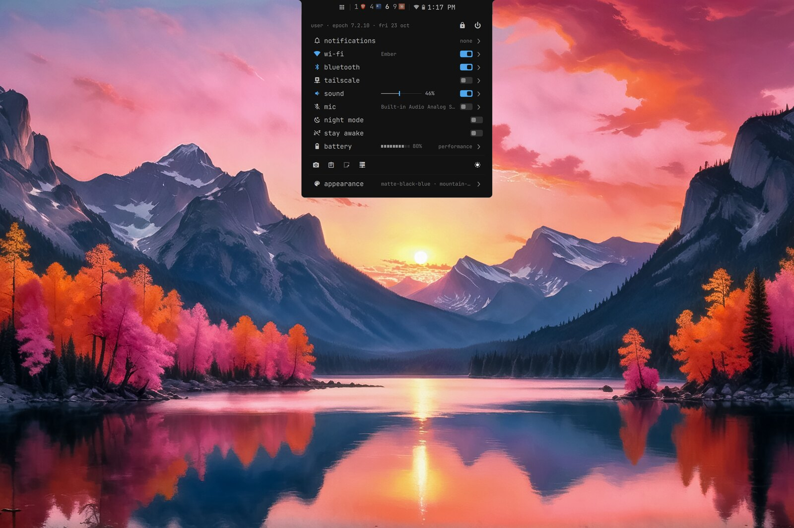
</p>

## About

Epoch Shell is everything around your windows: the bar, launcher, quick settings, notifications,
OSDs, lock screen, polkit prompt, and wallpaper. It stays out of the way until you reach for it.

The look is a single **readout**: monospace text, thin rules, one accent colour, rows that read
top to bottom like an instrument panel. Every surface uses that grammar — the dashboard, the
launcher, the settings card, the lock screen — so nothing feels bolted on. Panels grow out of the
bar rather than floating over it, and the bar itself can sit full width, float, or hang from the top
edge as a small centered ledge.

It is three projects that work as one:

| Project | Role |
| ------- | ---- |
| **EpochShell** (this repo) | The QML front end: everything you see. |
| [**EpochOxide**](https://github.com/bjsemrad/epochoxide) | A Rust daemon that does the heavy lifting: launcher search, files, clipboard, wallpapers, capture, Tailscale, LocalSend, firmware and Nix updates. The shell talks to it over a Unix socket. |
| [**epochctl**](https://github.com/bjsemrad/epochctl) | The command line: keybindings and scripts drive the shell through it (`epochctl launcher open`, `epochctl theme set`, `epochctl lock`). |

The shell is opinionated and deliberately small. It keeps only what a daily desktop uses and
prefers a codebase you can read in an afternoon over a framework with a setting for everything.
Every size, gap, and alpha is a named token in `commonwidgets/Ui.qml`, and every colour comes from
the theme.

## A tour

### The bar

Five layouts, all set live from the Appearance card. From the top: **full**, **floating**,
**floating with individual status icons**, **pill workspaces**, and the **centered ledge** used in
these screenshots, which hangs from the top edge and widens to hold whatever opens out of it. Full
width with individual icons is the default.

<p align="center">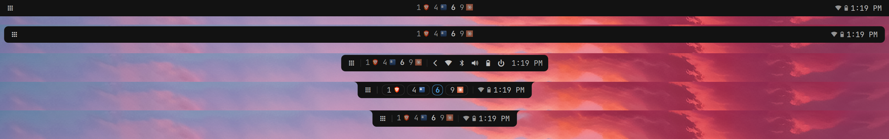</p>

Workspaces come as a **minimap** of each workspace's columns (niri) or windows (Hyprland), as
pills, plain numbers, or a ledge of app icons. Status is either one icon per service or a single
capsule that opens the dashboard.

### Dashboard

Quick settings in one column: Wi-Fi, Bluetooth, Tailscale, sound and mic, night mode, stay awake,
battery and power profile, capture and recording, and the appearance controls. Every row with a
chevron opens a page in place.

<p align="center">
  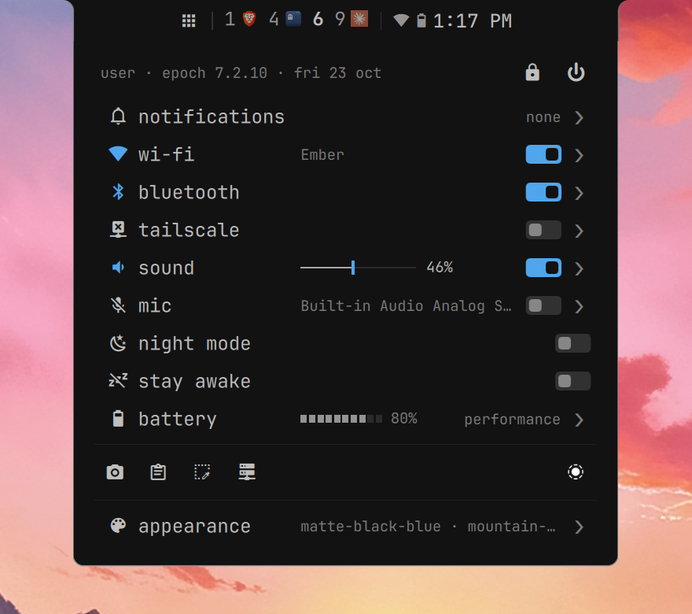
  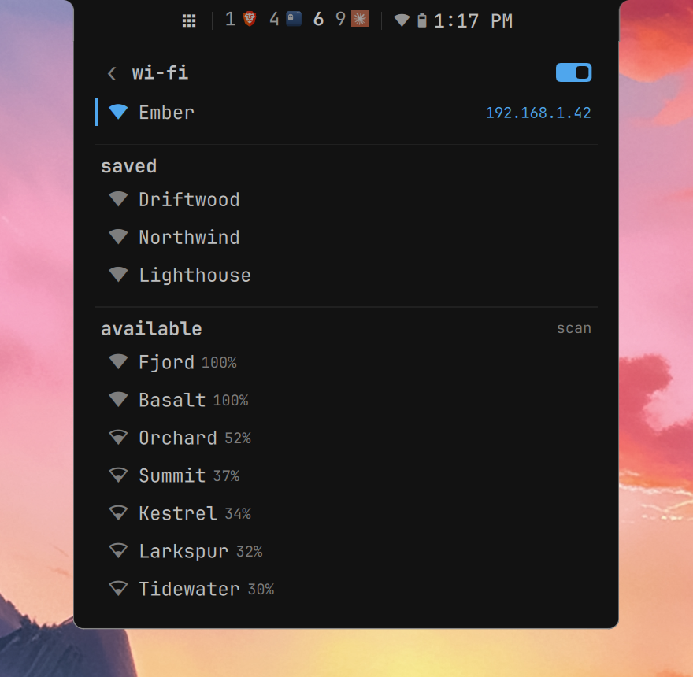
</p>
<p align="center">
  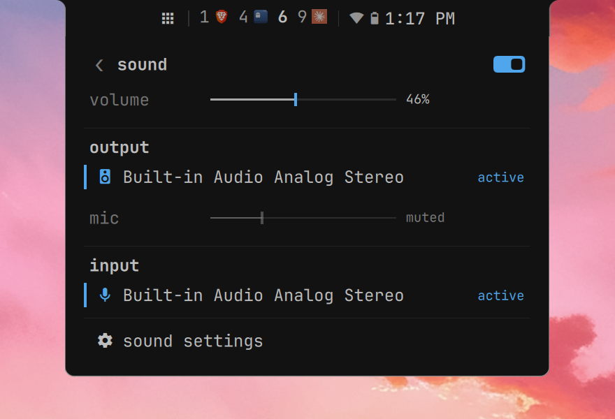
  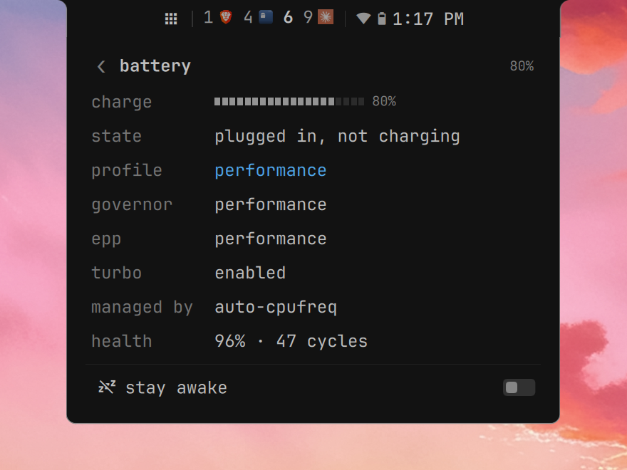
</p>

### Launcher

Applications, files, clipboard history, windows, a calculator, a command runner, and any custom
menu you write: all one launcher, backed by EpochOxide's providers. On the ledge it drops out of
the bar like the dashboard does; elsewhere it floats. A prefix jumps to a provider, and `;` lists
them all.

<p align="center">
  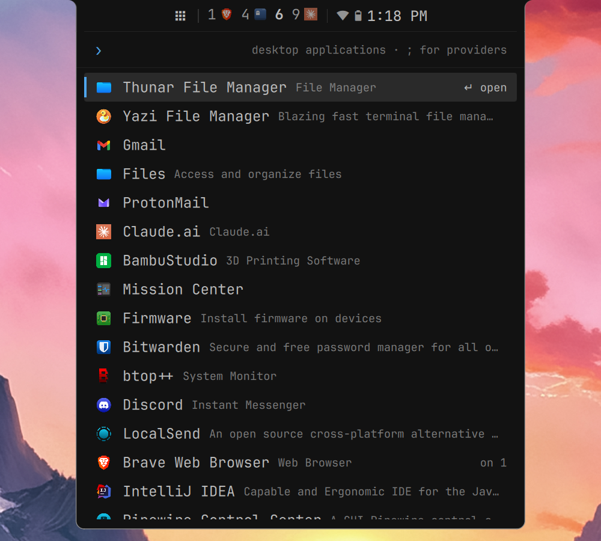
  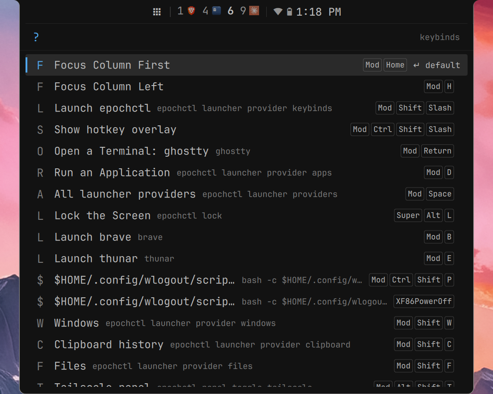
</p>

The keybinds menu above is a custom menu: it reads the running compositor's binds, so it is always
current.

### Appearance

One card for the whole look: bar layout, workspace style, panel style, opacity, blur, and gaps.
Changes apply as you make them and persist across rebuilds, even on a read-only home-manager
install.

<p align="center">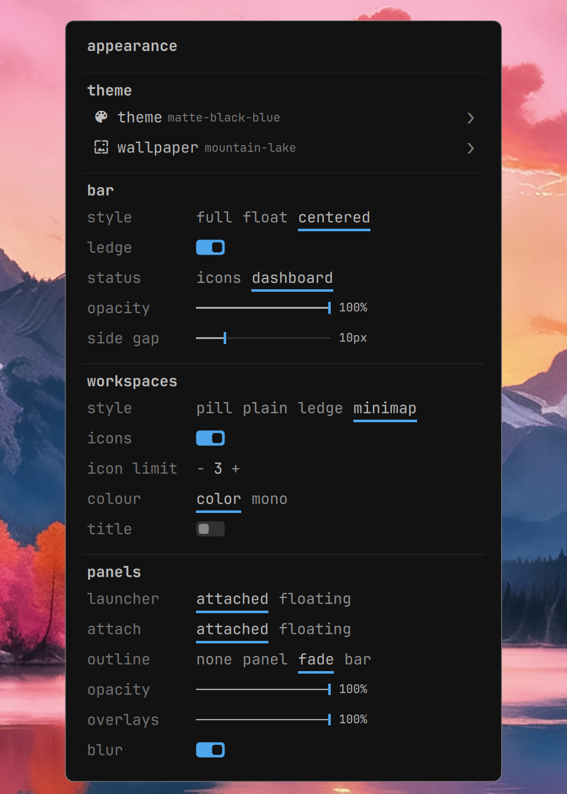</p>

### Themes and wallpapers

Twenty-two themes ship enabled, with seventeen more you can switch on. Pick one from a strip along
the bottom of the screen — moving the selection wears the theme, so you see it on the real desktop
rather than in a thumbnail. The wallpaper strip works the same way, with a crossfade.

<p align="center">
  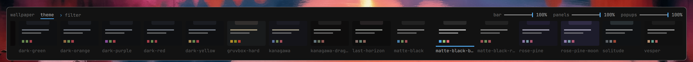
  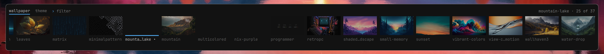
</p>

### And the rest

<p align="center">
  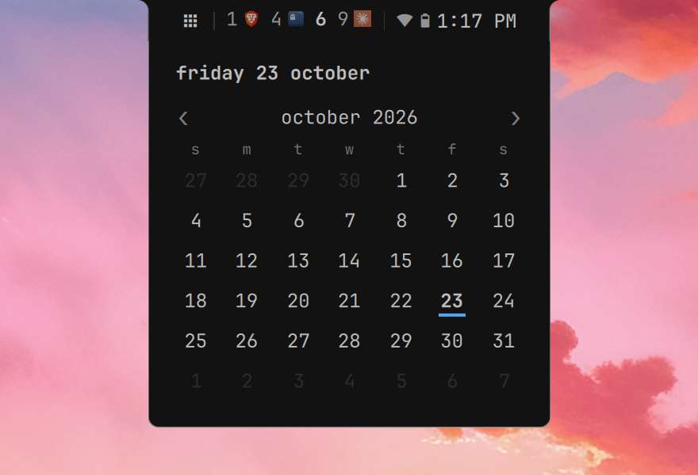
  
</p>

- **Notifications** with history, do not disturb, and image previews.
- **OSDs** for volume, media, brightness, and keyboard backlight. They stay quiet when the
  dashboard already shows the change.
- **Lock screen** over every monitor, with password and fingerprint at the same time, and a crash
  that relocks instead of unlocking.
- **Polkit agent** with a fingerprint-aware prompt.
- **Idle**: lock, screen off, and suspend timers, with a lock before every sleep.
- **Capture**: region, window, and screen shots, OCR to the clipboard, and screen recording with a
  bar indicator.
- **Nix panel** that shows which flake inputs can update and runs the update and rebuild in a
  terminal.
- **Tailscale, LocalSend, and firmware** panels that appear in the bar only when they have
  something to say.

## Install

Epoch Shell is a flake with a Home Manager module, which installs the shell, EpochOxide, and
epochctl and runs them as user services:

```nix
# flake.nix
inputs.epochshell.url = "github:bjsemrad/EpochShell";

# home.nix
imports = [ inputs.epochshell.homeManagerModules.default ];
programs.epochshell.enable = true;
```

Then bind the launcher and lock in your compositor, for example in niri:

```kdl
Mod+Space   { spawn "epochctl" "launcher" "open"; }
Super+Alt+L { spawn "epochctl" "lock"; }
```

Everything else is set from the Appearance card or `epochctl`; see [Configuration](#configuration)
for the keys you can pin in Nix.

## Layout

```text
quickshell/
  shell.qml                  # Shell root
  Bar.qml                    # Top bar
  Polkit.qml                 # Polkit authentication prompt
  Notifications.qml          # Notification windows
  SoundOSD.qml               # Volume OSD (and the media, brightness and backlight ones beside it)
  commonwidgets/             # Shared UI: rows, switches, sliders, and Ui.qml's design tokens
  modules/                   # Bar modules, launcher, lock screen, settings, theme and wallpaper strips
  popups/                    # Panels and dashboard pages
  services/                  # QML singletons and backend integrations
  theme/Config.qml           # Defaults, theme selection, and TOML overrides
  theme/themes/*.toml        # Shipped palettes
docs/screenshots/            # The images in this README
```

## Running locally

Run the checkout directly. Stop the installed service first, or the two will fight over the
notification and polkit names:

```bash
systemctl --user stop epochshell.service
quickshell -p quickshell -vv --log-rules 'qt.text.font.db=false'
# Ctrl-C when done, then
systemctl --user start epochshell.service
```

## Launcher

The launcher is implemented in `quickshell/modules/LauncherOverlay.qml` and uses `quickshell/services/LauncherService.qml` to query EpochOxide over `$XDG_RUNTIME_DIR/epochoxide.sock`.

The launcher icon on the bar opens it on applications. From a keybinding:

```bash
epochctl launcher open
epochctl launcher toggle
```

With the bar as a centered ledge the launcher drops out of the bar like the dashboard; otherwise,
or with `launcherStyle = "floating"`, it is a card below the bar. Opening it closes any open
panel, and opening a panel closes it.

Provider prefixes come from EpochOxide itself: the launcher reads the `providers` response and
routes on the `prefixes` each provider reports (configured under `[query_prefixes]` in the
EpochOxide config), so the shell never hardcodes them. With the EpochOxide defaults that is:

| Prefix | Provider |
|--------|----------|
| `/` | Files |
| `>` | Runner |
| `#` | Clipboard |
| `@` | Windows |
| `=` | Calculator |

Each custom menu in EpochOxide's `menus_dir` is a provider of its own, named after the menu, so it
takes a prefix the same way and is jumped straight into rather than drilled down to. Giving the
keybinds menu `?` is a `"?" = "keybinds"` line in `[query_prefixes]`.

Two prefixes are the shell's own, not the backend's:

| Prefix | Meaning |
|--------|---------|
| `*` | All available providers |
| `;` | Provider picker (lists every live provider with its prefix) |

Typing a math expression can route to the calculator provider automatically when `calc` is available.

The launcher IPC can jump straight to any provider, which is how the compositor binds open a menu:

```bash
qs ipc -p ~/.config/epochshell call launcher openProvider keybinds
```

Bitwarden/rbw support is intentionally not included in the current config.

### Custom menus

A menu is a TOML file in EpochOxide's `menus_dir` (`~/.config/epochoxide/menus`), and each one
becomes a provider named after the menu — searched by prefix, listed in the picker under its own
name and icon. Entries either run a command on Enter or hand back text to copy, and `command`
replaces the entry list with a generator that produces them live. See EpochOxide's README for the
file format; the shell reads whatever the backend reports.

An `icon` is either a freedesktop icon name resolved through the icon theme (`input-keyboard`) or
a Nerd Font glyph drawn in the theme font (`icon = "󰌌"`), at menu level, entry level, or both —
a menu's icon is the fallback for entries that name none. Anything short and outside the ASCII
range is treated as a glyph, so icon names are never mistaken for one.

Menus are deployed the same way as everything else here — from the dotfiles repo, not by hand.
`users/brian/modules/epochshell/` holds the keybinds menu: `menus/keybinds.sh` reads the running
compositor's binds (niri's `config.kdl`, else `hyprctl binds` cross-referenced against
`hyprland.lua` so a Lua config's binds still get readable names), wrapped in a derivation that
carries its own `jq`/`python3`, and a `home.file` entry writes the `keybinds.toml` that points at
it. The shortcut is one line in the EpochOxide settings:

```nix
programs.epochshell.epochoxide.settings.query_prefixes = {
  "?" = "keybinds";
};
```

Home Manager installs and starts EpochOxide by default when EpochShell is enabled. The backend can be configured through `programs.epochshell.epochoxide`:

```nix
programs.epochshell = {
  enable = true;

  epochoxide = {
    enable = true;
    enableService = true;
    socket = "%t/epochoxide.sock";
    runtimePackages = with pkgs; [ wl-clipboard xclip xdg-utils wmctrl tesseract libqalculate imagemagick librsvg fd ];
    settings = {
      file_roots = [ "~" ];
      persistent_index = true;
      provider_enabled.files = true;
      provider_enabled.clipboard = true;
    };
  };
};
```

Applications with `Terminal=true` in their desktop entry (yazi, btop) open in your terminal, the
one set by EpochOxide's `terminal_cmd`, else `$TERMINAL`, else the first of ghostty, kitty,
alacritty and foot that is installed.

## Polkit

`quickshell/Polkit.qml` registers a Quickshell polkit agent at:

```text
/org/epochshell/PolkitAgent
```

Only one polkit agent can be active for a session. If local development does not show the prompt, another agent is probably already registered. Check the logs for:

```text
epochshell polkit agent registered
```

Test a prompt with:

```bash
pkexec ls /root
```

The prompt supports password auth and a fingerprint waiting state when `pam_fprintd.so` is present in `/etc/pam.d/polkit-1`. It also checks laptop lid state and falls back to password when the reader is physically unavailable.

## Theming

The palette is a named theme file. Two ship with the shell, in `quickshell/theme/themes/`:

| Theme              | What it is |
| ------------------ | ---------- |
| `dark-deep`        | **The default.** `dark` on a deeper ground -- two lines, via `extends`. The built-in fallback is still `dark`, so a shell that finds no theme file at all lands one shade lighter rather than nowhere. |
| `dark`             | One Dark's palette on a near-black ground. Also mirrored as the built-in fallback in `theme/Config.qml`. Parent of everything below it. |
| `dark-*`           | `dark` in each of One Dark's other accents: `red`, `green`, `purple`, `orange`, `yellow`, `cyan`. One line each -- see **Extending a theme**. |
| `catppuccin-mocha` | Violet-tinted surfaces, close together. Catppuccin's darkest flavour. |
| `catppuccin-macchiato` | The same, one step lighter -- deep blue-black. |
| `catppuccin-frappe` | Lighter still: a blue-grey ground rather than a near-black one. |
| `kanagawa`         | Ink-dark and warm. Kanagawa's `wave`. |
| `kanagawa-dragon`  | Kanagawa's other dark variant: neutral and desaturated, darker ground. |
| `rose-pine`        | Soft and desaturated, iris accent. |
| `rose-pine-moon`   | The same palette on a lighter, bluer ground. |
| `last-horizon`     | Dusty rose and cool greys, desaturated throughout. |
| `solitude`         | Monochrome blue-greys with one saturated colour, kept for errors. |

Eighteen more ship alongside these with a `.toml.disabled` extension -- ayu-dark, batou, both
catppuccins' other half, dracula, everforest, flexoki-dark, ghost-pastel, both gruvboxes, light,
material-ocean, monokai, nord, one-dark, periphery, both solarizeds and tokyo-night. The scan globs
`*.toml`, so the extension is the whole mechanism: rename one back to re-enable it, no other change.

Every one is checked for contrast: text and accent against the ground, and a visible step between
the ground and the hover surface. Several needed adjusting off their canonical values to get
there -- usually a comment colour too dark to serve as hint text -- and each says which in its own
file.

Switch from the **theme strip**: the theme row on the dashboard's Appearance page, or the
Appearance card, opens it along the bottom of the screen, one tile per theme found on disk with a
swatch of its actual colours. **Moving the selection wears the theme** -- the whole shell repaints
so you see it rather than guess from a name -- Enter keeps it, and Escape puts back what you had.
Tab switches to the wallpaper strip.

The same switch from a terminal, a keybinding or a script, which keeps the choice across restarts:

```sh
epochctl theme list          # every theme that can be selected, and which is current
epochctl theme set light     # switch, and remember
epochctl theme get           # what is in force, and the file it came from
epochctl theme reset         # forget the pick, back to the configured default
```

The launcher reaches the same commands through the `themes` menu (see `epochoxide/examples/menus/themes.toml`).

### Extending a theme

A theme can build on another with `extends`, which is how the `dark-*` family stays one palette:

```toml
# dark-red.toml, in full
extends = "dark"

accent = "#e55561"
```

The parent is applied first, then the child's own keys on top, so a colour fixed in `dark` is fixed
in every variant. Inheritance is exactly one level deep -- a parent's own `extends` is ignored,
which means there is no cycle to worry about. A theme naming itself is ignored too.

The picker resolves this as well: a variant's swatch is drawn from the palette it inherits, not
from the two lines in its own file.

### Writing a theme

A theme is the same flat key/value format as `config.toml`, so it can set any key -- colours,
but also fonts and sizes if a theme wants a different feel. Copy one of the shipped files to
`~/.local/share/epochshell/themes/<name>.toml` and edit it; a user theme shadows a shipped one of
the same name, so `light.toml` there replaces the one below.

Precedence, lowest first:

1. Built-in defaults in `theme/Config.qml`
2. The theme file
3. `~/.config/epochshell/config.toml`

So a key set in `config.toml` holds whatever theme is selected, which is what you want for a
personal tweak and not what you want for a whole palette.

### Where things live

Themes and the selection are deliberately **not** kept beside `config.toml`. The flake installs the
whole shell tree at `~/.config/epochshell`, which on a home-manager machine makes that directory a
read-only symlink into the nix store -- nothing can be written there, and nothing written survives a
rebuild. So:

| What | Where |
| ---- | ----- |
| Shipped themes | `<shell root>/theme/themes/*.toml` |
| Your themes | `~/.local/share/epochshell/themes/*.toml` |
| The selected theme | `~/.local/state/epochshell/theme` |
| Key overrides | `~/.config/epochshell/config.toml` (see the caveat below) |

Both the theme files and the selection are watched, so a switch or an edit shows up without a
reload, and a second shell instance follows along.

`config.toml` can also name a starting theme, for a machine where that file is generated rather
than edited:

```toml
theme = "light"
```

A live `epochctl theme set` beats it; `epochctl theme reset` gives it back.

> **Caveat on `config.toml`:** on a home-manager install this file sits inside that read-only
> store symlink and so cannot exist at all. Overriding individual keys there is only available on
> an install that puts the shell somewhere other than `~/.config/epochshell`. Themes and theme
> selection work either way, which is why they live elsewhere.

## Wallpaper

A strip of thumbnails along the bottom of the screen, over whatever images are on disk. Reach it
from the **wallpaper row on the dashboard's Appearance page**, with `epochctl wallpaper toggle`, or bind it:

```lua
hl.bind("SUPER + SHIFT + B", exec("epochctl wallpaper toggle"))
```

Arrow keys to browse, Tab to switch to themes, Enter to keep, Escape to put back what was there. **Moving the
selection applies the wallpaper immediately** -- switching is a single call and the thing being
chosen is the whole screen, so there is no preview smaller or more honest than the real one.

Without opening anything:

```sh
epochctl wallpaper list        # every image found, current marked with *
epochctl wallpaper set <path>
epochctl wallpaper next        # cycle, for a keybinding
epochctl wallpaper refresh     # after adding images
```

### Where it looks

Set `wallpaper_dirs` in EpochOxide's `config.toml`. The default is:

```toml
wallpaper_dirs = [
  "~/.config/hypr",
  "~/Pictures/Wallpapers",
  "~/Wallpapers",
  "~/.local/share/wallpapers",
]
```

`~` is expanded, each directory is searched two levels deep for jpg, jpeg, png and webp, and one
that does not exist is skipped without complaint -- so dropping images into any of them just works.

The search follows symlinks, without which a home-manager wallpaper directory looks empty:
everything in it is a link into the nix store.

`~/Pictures` itself is deliberately not in the list. The scan goes two levels deep, so it would pull
in `~/Pictures/Screenshots` and bury the wallpapers under every screenshot ever taken.

### What draws it

Either the shell itself or hyprpaper, chosen by `wallpaper_backend` in EpochOxide's `config.toml`
(or `programs.epochshell.wallpaper.backend` in the home-manager module):

| `wallpaper_backend` | Who draws |
|---|---|
| `"auto"` (default) | hyprpaper if a hyprpaper process is running, the shell otherwise |
| `"shell"` | EpochShell, on a background layer surface |
| `"hyprpaper"` | hyprpaper, as described below |

So with `auto`, switching to the shell is just a matter of no longer starting hyprpaper. The status
the shell receives says which backend is active (`epochctl wallpaper list` and `wallpaper.status`),
and the shell only draws when that says `shell` -- it never paints under a running hyprpaper.

#### The shell

`modules/WallpaperBackground.qml` puts one `WlrLayer.Background` surface on each screen, namespace
`epochshell-wallpaper`, and shows whatever EpochOxide reports as current. A switch decodes the new
image behind the old one and crossfades, so there is no flicker and no restart, under Hyprland or
niri alike. All four fit modes work as named: `cover`, `contain`, `tile` and `stretch`. Images are
decoded at the screen's pixel size rather than the file's, and the old one is released once the
fade ends.

Switches reach the shell over `wallpaper.subscribe`, which EpochOxide fires whenever its state file
changes -- so `epochctl wallpaper next` from a keybinding lands at once, even one run while the
daemon was down.

The cost is that the wallpaper lives and dies with the shell: a crash or reload shows the theme's
background colour until the shell is back (systemd restarts it). Choose `hyprpaper` if that
matters to you.

**niri:** the overview draws its backdrop rather than the background layer, so to see the wallpaper
behind the zoomed-out workspaces add:

```kdl
layer-rule {
    match namespace="^epochshell-wallpaper$"
    place-within-backdrop true
}
```

#### hyprpaper

Under Hyprland, through `hyprctl hyprpaper wallpaper ",<path>,<fit_mode>"`, which switches with no
reload. Outside Hyprland hyprpaper turns its IPC off, so a switch repoints the symlink that
`hyprpaper.conf` draws from and restarts `hyprpaper.service`; if that config names a plain file
there is no way to switch at all, and the shell backend is the way out. Three things about
hyprpaper shape this:

- Its `listactive` reports what was loaded at startup and does **not** follow a live switch, so it
  cannot answer "what is set now". The shell remembers instead.
- Its config lives in `~/.config/hypr`, which on a home-manager machine is a read-only symlink into
  the nix store, so the choice cannot be written back there.
- A switch made this way inherits nothing from that config, fit mode included, so the mode has to
  travel with every switch. It comes from EpochOxide's `wallpaper_fit_mode`, which defaults to
  `stretch`.

Only `cover`, `contain` and `tile` actually work over IPC. Stretch cannot be reached at all in
hyprpaper 0.8.4: `hyprctl` parses `stretch`/`fit` into its STRETCH enum, hyprpaper serialises that
enum back to the string `"fit"` (`src/ipc/IPC.cpp`), and its own parser only accepts `"fill"` for
stretch (`src/ui/UI.cpp`), so it falls through and renders as `cover`. `fill` does no better --
`hyprctl` does not know that word and defaults it to `cover` too. Measured on 0.8.4: `stretch`,
`fit` and `fill` all render pixel-identical to `cover`, while `contain` and `tile` differ.

This is why `hyprpaper.conf` and a switch can disagree with nothing looking wrong: that file's own
`fit_mode = fill` *does* stretch, and no switch can reproduce it. Matching the two means either
setting the config to `cover` as well, or patching hyprpaper's `toFitMode` to accept `fit`.

One more trap when testing by hand: hyprpaper only re-fits when the target changes. Re-sending the
same image with a different mode does nothing at all, so a mode that works looks broken if the
image did not also change.

So the choice is kept in `~/.local/state/epochshell/wallpaper` and re-applied at startup. That is
what makes a switch outlive a reboot; without it hyprpaper would start from its own config again.
(The shell backend reads the same file, which is how it starts on the right image.)

Paths are used exactly as found -- `~/.config/hypr/foo.jpg`, not the `/nix/store` path it resolves
to. hyprpaper matches on the path it was given.

## Lock screen

```sh
epochctl lock
```

A session lock over every screen: the wallpaper blurred behind a clock, the password field, and the
battery. Type the password and press Enter, or touch the fingerprint reader if a finger is enrolled
-- both run at once, so neither waits on the other. Escape clears the field.

`epochctl lock` returns once the compositor has confirmed every screen is covered (or after three
seconds, saying it has not), so it is safe in a before-sleep hook. Locking twice is harmless. Locking
on idle, for `loginctl lock-session` and before sleep is built in -- see [Idle](#idle) -- or wire
`epochctl lock` into hypridle's `lock_cmd` and `before_sleep_cmd` if you keep that. And a key:

```kdl
Super+Alt+L { spawn "epochctl" "lock"; }
```

### How it holds

The lock is the compositor's, through ext-session-lock (Quickshell's `WlSessionLock`): niri,
Hyprland and sway all keep the screen covered until the locking client says otherwise, and keep it
covered if that client dies. On that basis:

- **Only a password or a fingerprint unlocks.** There is deliberately no unlock over IPC -- it would
  hand anything able to run `qs ipc` the one thing the compositor protects.
- **A crash does not unlock, and does not strand you.** The shell writes
  `$XDG_RUNTIME_DIR/epochshell-locked` before locking and removes it only after a real unlock; a
  shell that starts and finds it locks again at once, and the compositor gives the new instance the
  lock. **Hyprland needs `misc:allow_session_lock_restore = true` for that** -- without it a second
  lock client is refused and the way back is a TTY. niri allows it by default.

The password goes through PAM with the shell's own `quickshell/pam/password.conf` (pam_unix only),
not the system's login stack. Those usually put pam_fprintd first, and PAM runs in order, so a typed
password would sit behind the fingerprint reader's timeout. The fingerprint is checked separately
with `fprintd-verify`, retried for as long as the screen is locked.

### If it ever goes wrong

From a TTY (Ctrl+Alt+F2): `systemctl --user restart epochshell` relocks, and the new instance takes
input. As a last resort any other ext-session-lock client takes the lock over, e.g.
`WAYLAND_DISPLAY=wayland-1 hyprlock`.

## Idle

The shell can do hypridle's job itself: lock, power the screens off, and suspend after a while
untouched; lock for `loginctl lock-session`; and lock before every sleep, holding the sleep until the
lock is confirmed. With home-manager:

```nix
programs.epochshell.idle = {
  enable = true;
  lockAfter = 300;          # seconds; 0 turns a stage off
  screenOffAfter = 400;
  suspendAfter = 600;
  lockBeforeSleep = true;   # default
  afterSleepCommand = "";   # e.g. "openrgb -p Blue"
};
services.hypridle.enable = false;   # or both will act
```

That writes `~/.config/epochshell-idle.json`, which `modules/idle/Idle.qml` reads and watches, so a
rebuild applies without a restart. Without that file none of this runs. Without home-manager, write
the same JSON by hand:

```json
{ "lockAfter": 300, "screenOffAfter": 400, "suspendAfter": 600, "lockBeforeSleep": true, "afterSleepCommand": "" }
```

Details worth knowing:

- **Inhibitors.** Wayland idle inhibitors -- a playing video, the shell's own Stay Awake -- stop the
  timers. logind idle inhibitors (`systemd-inhibit --what=idle`) are checked when a stage would fire,
  and a stage held back fires once the inhibitor lifts, if the session is still idle.
- **Screens off** goes through the compositor EpochOxide reports (niri, Hyprland or sway), and comes
  back on with activity.
- **Before sleep**, a logind delay inhibitor (`epochshell`, in `systemd-inhibit --list`) makes the
  sleep wait for the lock, up to three seconds, so the machine never wakes showing the desktop.
- **`loginctl unlock-session` does nothing**, on purpose: only a password or fingerprint unlocks.
- Its helper processes (`gdbus monitor`, `systemd-inhibit`) are started with
  `setpriv --pdeathsig`, so a shell that is killed takes them with it.

## Configuration

Epoch Shell has built-in defaults in `quickshell/theme/Config.qml`. You can override any supported value with:

```text
~/.config/epochshell/config.toml
```

The file is optional. If it does not exist, defaults are used. If it exists, it is treated as a partial override: include only the keys you want to change.

The file is watched by Quickshell, so changes are reloaded at runtime.

Example:

```toml
accent = "#ff00aa"
background = "#0e1013"
fontFamily = "JetBrainsMono Nerd Font Propo"
fontSizeLarge = 22
barHeight = 44
workspaceStripMaxWidthRatio = 0.35
panelAnimationsEnabled = true
```

The parser supports flat TOML-style key/value lines:

```toml
key = "string"
key = 123
key = 0.45
key = true
```

Section headers are ignored, so grouped files like this are also accepted:

```toml
[theme]
accent = "#4fa6ed"
barHeight = 40
```

Unknown keys are ignored with a warning.

### Color Keys

```toml
accent = "#4fa6ed"
accentLightShade = "#1a4fa6ed"
inactive = "#bfa0a8b7"
active = "#a0a8b7"
activeSelection = "#282c34"
background = "#0e1013"
surface = "#1f2329"
surfaceVariant = "#323641"
surfaceContainer = "#1f2329"
surfaceContainerHigh = "#282c34"
surfaceContainerHighest = "#30363f"
surfaceText = "#a0a8b7"
outline = "#8c9199"
purple = "#bf68d9"
green = "#8ebd6b"
orange = "#cc9057"
blue = "#4fa6ed"
yellow = "#e2b86b"
cyan = "#48b0bd"
red = "#e55561"
bg_blue = "#61afef"
bg_yellow = "#e8c88c"
```

Derived colors such as `accentLightShade`, `inactive`, `active`, and `activeSelection` update automatically from their source colors unless explicitly overridden.

### Opacity and blur

```toml
barOpacity = 1.0      # the bar: 0 fully see-through, 1 solid
panelOpacity = 1.0    # the panels that grow out of the bar
popupOpacity = 1.0    # everything that floats free: OSDs, notifications, the launcher
blur = true           # blur behind the bar and panels while they are see-through
```

Everything ships solid. For a frosted look, turn the bar and panels down together -- 80% works
well -- so the two read as one sheet of glass, with the compositor blurring what is behind them.

The **Appearance** card (the dashboard's appearance row, or `epochctl settings toggle`) has a slider for each and a
switch for blur. Moving a slider applies it live; letting go writes it to
`~/.local/state/epochshell/settings.toml`. That matters on a home-manager install, where
`config.toml` cannot be written -- the settings file is writable and wins over both the theme and
`config.toml`.

Each applies the theme's `background` at that alpha, so a theme that changes the ground changes
these with it, and a theme may set any of them itself. Fills drawn on a see-through surface --
hovers on the bar, tiles and rows in a panel -- become a wash of the text colour rather than a solid
grey, so the frost carries through them.

Blur uses the `ext-background-effect` protocol, which niri (26.04 and later) applies with no
configuration. On Hyprland, a layer rule blurs the bar:

```lua
hl.layer_rule({
  name = "epochshell-blur",
  match = { namespace = "^(quickshell)$" },
  blur = true,
})
```

### Font Keys

```toml
fontFamily = "JetBrainsMono Nerd Font Propo"
fontSizeNormal = 14
fontSizeMedium = 16
fontSizeLarge = 18
fontSizeXLarge = 24
fontSizeSubtext = 11
```

### Bar Keys

```toml
barHeight = 40
barIconSize = 18
barClockSize = 11
barModuleSpacing = 10
barIconTextSpacing = 5
barModuleHorizontalPadding = 14
barModuleVerticalPadding = 10
workspaceIcons = true
workspaceStripMaxWidthRatio = 0.45
barFloatingGap = 4          # floating and centered: gap above the bar
barFloatingSideGap = 10     # floating: gap at each end
```

Derived bar values such as `barClockSize`, `barModuleHorizontalPadding`, and `barModuleVerticalPadding` update automatically unless explicitly overridden.

### Style Keys

```toml
barStyle = "full"           # "full", "floating" or "centered"
barLedge = true             # centered only: hang from the top edge instead of floating
statusStyle = "individual"  # "individual" icons, or "dashboard": one capsule opening quick settings
panelStyle = "attached"     # "attached" (grown out of the bar) or "floating" cards
panelOutline = "fade"       # "none", "panel", "fade" or "bar"
workspaceStyle = "minimap"  # "minimap", "pill", "plain" or "ledge"
workspaceIcons = true
workspaceIconLimit = 2      # ledge only: icons per workspace before "+n"
workspaceHomes = ""         # ledge only: "app:workspace" pairs; an app elsewhere stays in colour
launcherStyle = "attached"  # "attached" (drops out of a centered ledge) or "floating"
```

Every size, gap, alpha and duration in the shell is a named token in
`quickshell/commonwidgets/Ui.qml`; change one there and every surface follows.

### Popup And Card Keys

```toml
popupPadding = 10
popupRadius = 10
popupLayoutSpacing = 8
cardRadius = 10
cardHeight = 50
```

### Layout And Misc Keys

```toml
widthPaddingSmall = 14
layoutMarginSmall = 5
hideInactiveWorkspaces = true
```

### Switch Keys

For the switches in the Appearance window (`epochctl settings toggle`).

```toml
switchHeight = 42
switchWidth = 24
switchKnobSize = 20
switchKnobRadius = 10
```

## Nix Updates

The Home Manager module carries the flake watcher's settings, which it passes to EpochOxide:

```nix
programs.epochshell.nixUpdates = {
  enable = true;
  flake = "~/nixconfig";
  checkIntervalMinutes = 60;
  updateCommand = "nixupdate";          # runs through your login shell, so aliases work
  hosts = [
    { name = "thor"; rebuild = "nixswitch"; }
  ];
};
```

Checking never writes to the flake. `updateCommand` and each host's `rebuild` run in a terminal, in
the flake's directory, through your login shell interactively -- so a shell alias is a valid
command here -- and the terminal stays open when the command finishes so its output survives.

Hosts you do not list are read from the flake's `nixosConfigurations` and fall back to
`rebuildCommand` with `%HOST%` substituted; with no `rebuildCommand` they are shown without a
rebuild action rather than with one that cannot work.

## Dependencies

Epoch Shell expects these tools/services to be available in the session:

- `quickshell`
- `epochoxide` for launcher results, activation, Tailscale state/actions, LocalSend
  discovery/transfers, and screen capture
- `grim`, `slurp`, and `libnotify` for screenshots: EpochOxide takes the shot and announces it with
  `notify-send`, which this shell answers as the session's notification server. The Home Manager
  module installs all three.
- `tesseract` for the capture panel's OCR row; the panel hides it when tesseract is missing.
- `wf-recorder` for the record panel and its bar indicator, dimmed and disabled the same way.
- `nix` and a terminal for the Nix panel's check, update, and rebuild actions.
- `wpctl`/PipeWire stack for audio controls
- `networkmanager` stack for network controls
- `bluetoothctl`/BlueZ stack for Bluetooth controls
- `tailscale` for EpochOxide's Tailscale backend
- LocalSend needs no local app: EpochOxide speaks the protocol itself, so the panel finds devices
  whether or not the desktop app is running here
- `pkexec`/polkit for privileged auth prompts
- Optional `pam_fprintd.so` configuration for fingerprint auth

Some modules are compositor-aware. Hyprland and Niri support are represented by compositor services and workspace modules.

## Development Notes

- The active shell root is `quickshell/shell.qml`.
- Theme and sizing defaults live in `quickshell/theme/Config.qml`; palettes live in `quickshell/theme/themes/`.
- QML services are registered in `quickshell/services/qmldir`.
- The codebase intentionally omits an overview and Bitwarden/rbw support.
- Live installed config may be generated or read-only depending on the system setup; for development, run directly with `quickshell -p` from this repo.
- `nix develop` gives you the whole stack rather than just Quickshell: EpochOxide and epochctl too,
  since the QML talks to one over a socket and is driven by the other over IPC. It also brings
  `qmllint`, `qmlformat` and `qmlls`.
- `qs-lint` (in that shell) runs qmllint over `quickshell/` with the imports resolved. QML tooling
  cannot see Quickshell's `qs.*` modules on its own, so it is run against a throwaway tree of
  symlinks with generated `qmldir` files; the checkout is never written to. Without that, every
  `T.Config.*` reference is reported as unqualified access and the real findings are lost in them.
